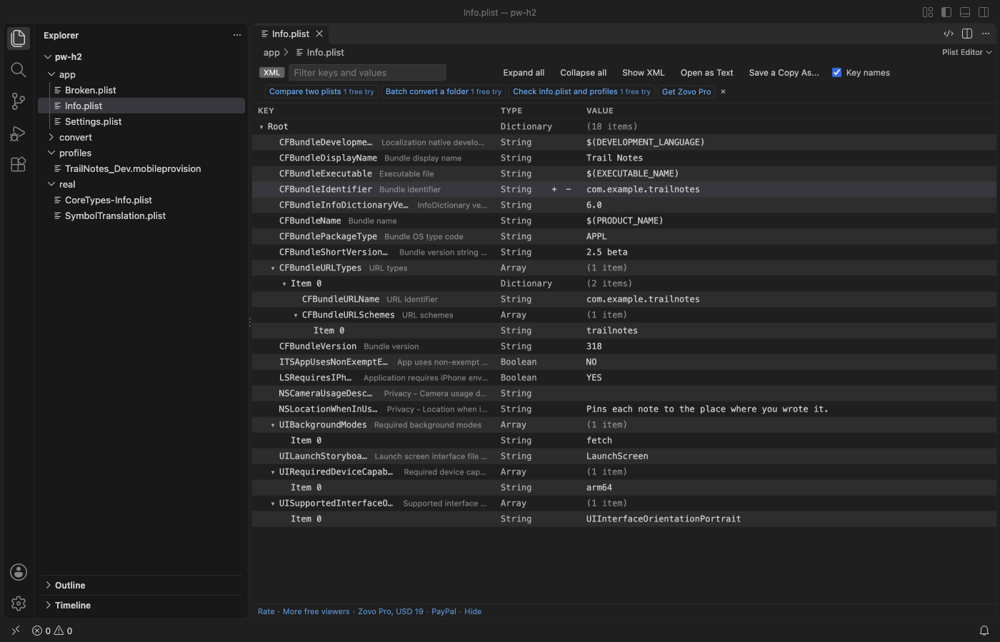

# Plist Viewer & Editor (Binary)

Plist editor by Zovo for VS Code: open binary, XML and OpenStep property lists as a Key, Type and Value tree, the way Xcode shows them, and edit them in place. A binary plist is saved back as binary and an XML plist as XML with its own indent. Info.plist, entitlements, privacy manifests and provisioning profiles open too. Works offline on macOS, Windows and Linux, with no plutil and no account.

## Free

- Open `.plist` files in all three formats: binary (`bplist00`), XML and OpenStep (old-style text). The format shows in the toolbar.
- Edit as a tree: double-click a key or value, click the type to change it (String, Number, Boolean, Date, Data, Array, Dictionary), `+` adds an item, `-` deletes one, Alt+Up and Alt+Down reorder, Ctrl+D (Cmd+D) duplicates. Undo, redo, save and hot exit work like any file.
- Save in the format the file came in: binary stays binary, XML keeps its prolog, indent and line ends. A file you only open is never rewritten.
- Readable names and short notes for about 120 known Info.plist, entitlements and profile keys, next to the raw key (turn off with the Key names box).
- Filter keys and values (Ctrl+F or Cmd+F), Expand all, Collapse all, and a right-click menu to copy a key, a value, a key path, or a subtree as XML or JSON.
- Show XML: a read-only XML copy of the tree next to the editor that follows every edit. Open as Text for XML files.
- Save a Copy As XML, binary, JSON or OpenStep, with a note when the target format cannot hold a value (JSON has no dates, OpenStep has no numbers).
- `.mobileprovision` and `.provisionprofile` files open read-only as a tree (expiry, team, devices, entitlements). `.entitlements` and `PrivacyInfo.xcprivacy` open as plists.
- Large files stay fast: only the rows on screen are drawn.
- No network requests, no telemetry, nothing shows when VS Code starts.

## Zovo Pro

Zovo Pro: USD 19 once. One payment unlocks the Pro tools in every Zovo extension. Each Pro tool has 1 free try on your computer first:

- Compare two plists: a tree compare with key order ignored, against another file, the git HEAD version or the saved file (for unsaved edits). Added, removed and changed keys with old and new values; Save as Markdown for a pull request.
- Batch convert a folder: every plist in a folder to XML, binary or JSON, into a new folder or in place with a backup of each original, with a dry run and a report of what changed and what was skipped.
- Check Info.plist and profiles: the problems App Store Connect and App Review refuse, such as a bad bundle id or version format, empty or vague privacy texts, a missing launch screen, invalid URL schemes, wrong value types, an expired profile or certificate, and a bundle id that does not match the provisioning profile. Each finding links to its row in the editor.

The Pro tools are in the editor toolbar, the Command Palette (they end in "(Pro)") and the Explorer right-click menu ("Zovo Pro: ..."). The try counts only when the tool showed its result, and after it the next use opens the Zovo Pro panel, on any file; Escape never uses one. `plistEditor.showProTools: false` hides all of it.

Run Zovo Pro: Get Zovo Pro to pay by card, with GitHub Sponsors or PayPal (team of 5: USD 59), or to enter a key.

## How to use it

Click a `.plist` file in the Explorer: it opens in the tree editor. To read an XML plist as text, use Open as Text in the editor toolbar, or right-click the file and choose Open With... > Text Editor. To make the text editor the default for XML plists, add `"workbench.editorAssociations": { "*.plist": "default" }` to your settings; Open in Plist Editor in the editor title bar brings the tree back.

| Keys | What they do |
|---|---|
| Enter | Edit the key (or the value of an array item) |
| Tab | From the key to the value |
| Ctrl+Enter (Cmd+Enter) | Add an item below, or inside an open dictionary or array |
| Delete | Delete the row |
| Alt+Up, Alt+Down | Move the row |
| Left, Right | Close or open a dictionary or array |
| Ctrl+F (Cmd+F) | Filter keys and values |

## Settings

- `plistEditor.showKeyNames`: readable names next to known keys (default on).
- `plistEditor.maxFileSizeMB`: larger files open with a message instead of the tree (default 100).
- `plistEditor.showProTools`, `plistEditor.askForRating`, `plistEditor.showSupportLinks`.

## Privacy

No network requests and no telemetry. Files are read from and written to your disk only. Compare with git HEAD runs your local `git show`, only in a trusted folder.

## Known limits

- Comments in OpenStep plists are not kept when you save (the file is written again from the tree). XML comments are not kept either.
- An XML plist that was formatted by hand (blank lines, `<array></array>` instead of `<array/>`) is written in Apple's layout when you save it; the values do not change.
- Signed provisioning profiles are read-only: editing would break the signature.
- Dates in XML plists have whole seconds; binary plists keep fractions of a second.
- `.strings` localization files and Xcode `project.pbxproj` files are not opened by default (their comments matter). Open With... > Plist Editor reads them, and saving drops their comments.

## Support Zovo

Zovo Pro: USD 19 once, every Zovo viewer. [Get Zovo Pro on GitHub Sponsors](https://github.com/sponsors/theluckystrike/sponsorships?tier_id=679878) to turn on the Pro tools in this extension and in the other Zovo extensions you use. The free features stay free.

Zovo extensions have no ads and no tracking. They are made by [theluckystrike](https://github.com/theluckystrike) on GitHub. You can also support the work with no Pro:

- [Sponsor on GitHub](https://github.com/sponsors/theluckystrike)
- [PayPal](https://www.paypal.com/paypalme/najzzz)
- [Follow theluckystrike on GitHub](https://github.com/theluckystrike)

### Need your format supported?

Open a [format request](https://github.com/theluckystrike/plist-editor-vscode/issues/new?template=format-request.yml) with a sample file, and I reply there whether it can be done. For USD 299 once, through [this GitHub Sponsors tier](https://github.com/sponsors/theluckystrike/sponsorships?tier_id=679995), I add your file format or a missing feature to this extension, with tests, within 7 days.

## More tools by Zovo

- [Hex Viewer & Binary Viewer, Hex Editor (Large Files)](https://marketplace.visualstudio.com/items?itemName=zovo.zovo-hex-viewer) opens binary files of any size, with find, a data inspector and byte editing.
- [SVN Client & Subversion Source Control (Commit, Blame, Log, Diff)](https://marketplace.visualstudio.com/items?itemName=zovo.zovo-svn-client) brings SVN commit, diff, log and blame to the Source Control view.
- [ZIP Viewer & Archive Explorer (JAR, TAR, GZ)](https://marketplace.visualstudio.com/items?itemName=zovo.zip-archive-explorer) browses ZIP, JAR, VSIX, TAR and GZ files, opens entries in tabs and extracts them safely.
- [VCD Viewer & Waveform Viewer (Verilog, No Signal Limit)](https://marketplace.visualstudio.com/items?itemName=zovo.zovo-vcd-waveform-viewer) opens Verilog, SystemVerilog and VHDL VCD waveforms with no signal limit.
- [Linker Map Viewer & Map File Analyzer (GNU ld, Memory Usage)](https://marketplace.visualstudio.com/items?itemName=zovo.zovo-linker-map-viewer) shows FLASH and RAM use from GNU ld, lld, IAR and Keil map files.

See [all Zovo extensions on the Marketplace](https://marketplace.visualstudio.com/publishers/zovo).
